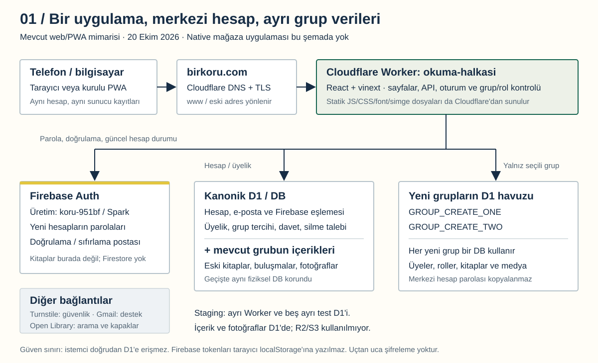
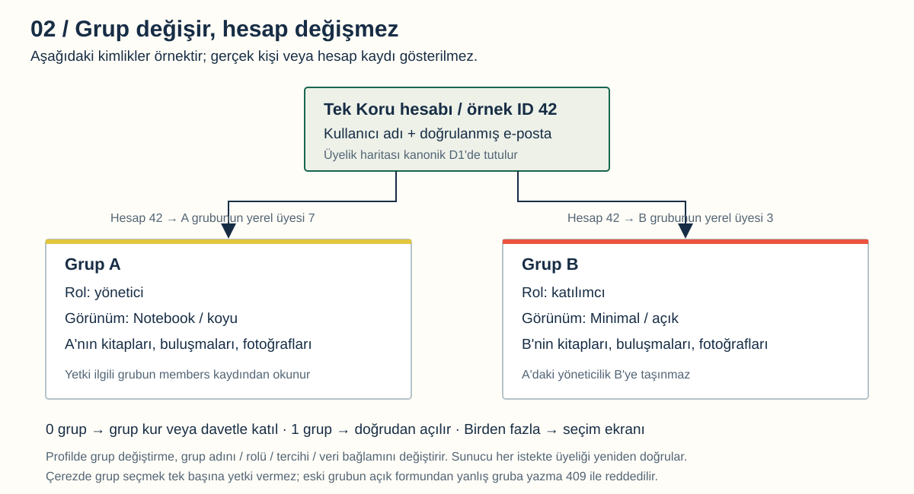
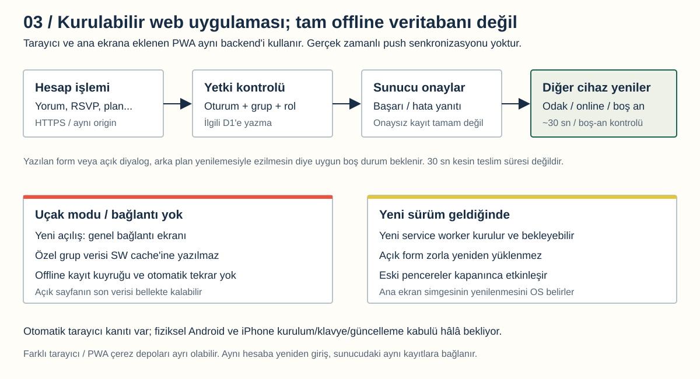

# Koru: Güncel Mimari ve Eksikler

20 Ekim 2026. Mimari envanteri; güvenlik/hukuki uygunluk sertifikası değildir.
[Görsel raporu aç](architecture/index.html). Diyagramlar bu dosyayla aynı
17:52 TRT snapshot'ını anlatır; bu ilk envanter çalışması uygulamayı değiştirmedi.

**23:18 TRT ek yayını:** Ortak grup depolaması artık canlıda (`d6a1c4d`, Worker
`fc31de5a-5c8f-4e7b-9645-81f151453374`). Yeni gruplar kanonik D1'de tenant
alanlarıyla ayrılıyor; eski grupların depoları ve üç DB bağlantısı korunuyor.
Toplam üç grup/havuz darboğazı kalktı; hesap/kota sınırları sürüyor. Aşağıdaki
sayaçlar ve diyagramlar ilk tarihli envanterdir, güncel grup sayacı değildir.
Yeni mimari/kanıtlar: [Ortak Grup Depolaması](SHARED_GROUP_STORAGE.md),
[Son Yayın Kaydı](FIREBASE_PRODUCTION.md). 13 manuel kabul başlığı hâlâ bekliyor.

## 1. Durum Özeti

**Koru yayında; bütün üretim kabul maddeleri kapanmış değil.** İlk genel
açılış Mustafa'nın açık kararıyla, eksik insan/cihaz kanıtları beklemede
bırakılarak yapıldı. Standart yayın kapısı geçmiş gibi gösterilmedi.

| Başlık | Doğrulanan durum |
| --- | --- |
| Canlı adres | https://birkoru.com; www ve eski workers.dev adresi buraya yönlenir |
| Uygulama Worker'ı | `okuma-halkasi` |
| Yayınlanan uygulama kaynağı | `1c1b235d75e0162a1c1bd3b6387bb07ce5eececf` |
| Yayında kaydedilen Worker sürümü | `7a93d173-3973-45e3-a05b-0691abad4c6e` |
| Üretim kimlik sağlayıcısı | Firebase Authentication, `koru-951bf`; Spark operatörce teyitli |
| 17:49 TRT salt okunur önkontrol | Üç bağlı üretim D1'i, gereken ayar/tablolarda sıfır engel |
| 17:52 TRT anonim toplam sayaçları | Altı hesap, bir kayıtlı grup, iki boş yeni grup havuzu |
| Cloudflare hesabı | Sekiz D1: üç üretim + beş staging; kalan hesap kotası ile uygulama havuzu aynı şey değil |
| Yayın sırasında koruma | 13 eski tablo/75 satır, hesap kimlikleri, roller, parola özetleri ve medya birebir korundu; 21 tablo eklendi |
| Staging | Ayrı Worker/veritabanları; canlıya kopyalanmadı |
| Native Android/iOS | Bu genel yayının parçası değil; sonraki aşama |

Gün içindeki sayaçlar sonradan değişebilir. Üretim önkontrolü şema/ayar
kontrolüdür; posta teslimi, gerçek kullanıcı girişi veya güvenlik denetimi değildir.
Sonraki dokümantasyon commit'leri, yayınlanan uygulama kodunun farklı olduğu
anlamına gelmez. Çalışan sürüm ile raporun kaynak commit'i ayrı kaydedilmelidir.

## 2. Büyük Resim

Koru, birden fazla ayrı uygulama değil, **ortak backend kullanan bir web/PWA
uygulamasıdır**. Telefon tarayıcısı, bilgisayar ve ana ekrana eklenen sürüm
aynı HTTPS API'sine bağlanır. Cloudflare Worker, isteğin kimden geldiğini ve
hangi gruba erişebileceğini belirleyip doğru D1 bağlantısını seçer.

| Katman | Gerçekte kullanılan yapı | Görevi |
| --- | --- | --- |
| Arayüz | React 19, TypeScript, Tailwind 4, Hugeicons | Kitap, buluşma, plan, profil ve hesap ekranları |
| Web çalışma katmanı | Next App Router tarzı dosyalar/API'ler; vinext 1.0.0-beta.5, Vite 8 | React sunucu belgesi ve tarayıcı paketinin Workers'a uyarlanması; klasik kalıcı Node/Express sunucusu değil |
| Uygulama backend'i | Cloudflare Worker | Aynı origin API, oturum, yetki, kayıt/davet ve grup işlemleri |
| Veri erişimi | D1 hazırlanmış SQL sorguları ve batch işlemleri; Drizzle şema/migration tanımları | Parametreli sorgu, FK ve atomik tek-DB işlemleri; bütün erişim yalnız ORM üzerinden yapılmıyor |
| Kimlik | Firebase Authentication | Yeni parola doğrulama, e-posta doğrulama, sıfırlama ve sağlayıcı hesap durumu |
| Veri | Cloudflare D1 / SQLite | Hesap eşlemesi, grup üyeliği ve içerikler |
| Dosyalar | Korunan D1 `media.data` BLOB kayıtları | Kullanıcı fotoğrafı, avatar ve yüklenmiş kapak; R2/S3/Firebase Storage değil |
| Kamusal varlıklar | Cloudflare Static Assets | JS/CSS, yerel fontlar, yeni logo/simgeler, sosyal görsel ve offline kabuk |
| Güvenlik/harici servis | Turnstile, Open Library | Kayıt/kurtarma güvenlik kontrolü, kitap arama/harici kapaklar |
| Destek | `koru.destek@gmail.com` | İnsan destek yazışması; üretim doğrulama postalarını Gmail API değil Firebase gönderir |

Firebase **Firestore**, uygulamada Firebase Analytics, gerçek zamanlı WebSocket
veri servisi, sunucudan push senkronizasyonu veya çevrimdışı yazma kuyruğu bu
mimarinin parçası değildir. Sunucusuz çalışmak sunucunun/veri sorumlusunun
olmadığı veya kota/işletim ihtiyacının kalmadığı anlamına gelmez.

## 3. Veriler Nerede?

### Kanonik D1: ortak hesap ve mevcut grup

`DB`, tek hesabın kalıcı uygulama kimliğini tutar: `member_accounts`,
`account_profiles`, `firebase_links`, `firebase_sessions`, `reading_groups`,
`reading_group_memberships`, davet/provizyonlama, ilk tur ve silme talepleri.
Kalıcı silme iş günlüğü ve sağlayıcı checkpoint'leri de buradadır.

**Önemli istisna:** eski/default grubun kitapları, üyeleri, buluşmaları ve
fotoğrafları da aynı fiziksel kanonik D1'de kalır. Veriler kaybolmasın diye
geçişte burası yeniden kurulmadı. Dolayısıyla "hesapların DB'si + her grubun
tamamen ayrı DB'si" ifadesi mevcut grup için fiziksel olarak tam doğru değildir.

### Yeni grup D1'leri

`GROUP_CREATE_ONE` ve `GROUP_CREATE_TWO` kalıcı üretim havuzlarıdır. Her biri
bir yeni grubun yerel üyelerini, rollerini ve içeriklerini alır. Kullanıcı
"grup kur" dediğinde hazır boş bağlantılardan biri ayrılır; kullanıcı isteği
Cloudflare hesabında sınırsız yeni veritabanı oluşturmaz. Hesap parola/Firebase
oturumları yeni grup DB'sine kopyalanmaz. Ortak eski şema nedeniyle boş bir
`member_accounts` tablosu bulunması, oraya kimlik verisi kopyalandığı anlamına gelmez.

### Kullanıcıya göre veri envanteri

| Veri | Depo / sınır |
| --- | --- |
| Yeni hesabın parola doğrulama verisi | Firebase Authentication; Koru yeni parola hash'i yazmaz |
| Eski hesabın hash ve salt'ı | Firebase'e doğrulanmış bağlanma tamamlanana kadar kanonik D1 |
| E-posta, ad, kullanıcı adı, UID eşlemesi | Kanonik D1; kimliğin ilgili kısmı Firebase'de de işlenir |
| Hesap-grup üyeliği, tema ve açık/koyu tercihi | Kanonik `reading_group_memberships`; hesap + grup başına |
| Grup rolü | O grubun D1'indeki yerel `members` kaydı |
| Kitap, plan, buluşma, katılım/RSVP, yorum, oy, favori | Seçili grubun D1'i; default grup için kanonik D1 |
| Kullanıcı fotoğrafı ve dosya anahtarı | Aynı grubun D1 BLOB'u ve ilişkili satırlar |
| Sunucu oturumu | HttpOnly çerezde uygulama tutamacı; D1'de şifreli sağlayıcı oturum bilgileri |
| Görünüm/kurulum ve gezinme tercihleri | Cihazdaki yerel depolama; grup tercihinin sunucu karşılığı ayrıca var |
| Destek mesajı | Gmail; kullanıcı bu kanaldan gönderdiği içeriği de paylaşmış olur |
| Şifreli işletim yedeği | Git dışı yerel dosya; ayrı anahtar dosyası aynı bilgisayarda |

HTTPS aktarımı korur; bu uygulama uçtan uca şifreli değildir. Yetkili teknik
işletmeci içeriklere erişebilir. Verilerin yalnız Türkiye'de kaldığı veya
gizlilik yükümlülüklerinin otomatik tamamlandığı iddia edilmez.

## 4. Tek Hesap, Çok Grup

Bir kişinin üç ayrı kimliği birbirine karıştırılmaz: Firebase UID, kanonik
Koru hesap kimliği ve ilgili grubun yerel üye kimliği. Diyagramdaki sayılar
temsili değerlerdir. Aynı kişi bir grupta yönetici, diğerinde katılımcı olabilir.

Girişten sonra sıfır üyelik varsa grup kurma/davetle katılma yolu; tek grup
varsa doğrudan açılış; birden çok grup varsa seçim ekranı kullanılır. Profilde
grup değiştirilebilir. Hesap aynı kalır; veriler, grup adı, yerel rol ve tasarım
tercihleri seçilen gruba göre yeniden yüklenir.

Sunucu, çerezdeki grup adını yetki kanıtı saymaz. Aktif üyeliği, DB binding
izin listesini, DB'nin grup sahipliğini ve yerel üyeyi/rolü kontrol eder.
Yazma isteğinin `X-Reading-Group` başlığı ve origin'i seçili bağlamla uyuşmalıdır.
Eski açık form yanlış grubun verisini değiştirmesin diye çakışma reddedilir.
İstek kapsamındaki DB seçimi `AsyncLocalStorage` ile taşınır.

Ürün adı, kurulu uygulama adı, logo ve kamusal paylaşım görseli **Koru** olarak
sabit kalır. Özel grup adı anonim sosyal önizlemeye veya manifest içine konmaz.
Dört şema (Editorial, Catalogue, Notebook, Minimal) ve açık/koyu mod korunur.

## 5. Kimlik ve Parola Akışı

### Yeni hesap

1. Koru formu girdileri, aynı origin'i, deneme sınırlarını ve Turnstile'ı denetler.
2. Worker, sabit üretim Firebase projesinde hesap oluşturma/doğrulama akışını yürütür.
3. Firebase posta gönderir; kullanıcı e-postasının sahipliğini doğrular.
4. Doğrulanmış sağlayıcı kimliği ile Koru üyelik hesabı eşlenir; başka birinin
   hesabı yalnız e-posta/isim benzerliğiyle sahiplenilmez.
5. Grup üyeliği ayrı adımdır; kayıt olmak mevcut özel gruba otomatik giriş vermez.

Kullanıcı şifresini Koru formuna yazar: parola HTTPS ile Worker'ın belleğinden
geçer ve Firebase'e iletilir. "D1'e hash yazmıyoruz" demek "uygulama parolayı
hiç işlemiyor" demek değildir. Düz parola loga veya rapora yazılmaz.

### Oturum

Worker, RS256 imzası/proje/issuer/süre/e-posta doğrulamasını denetler; ayrıca
Firebase'in güncel hesap/iptal durumunu sorgular. Sağlayıcıya erişilemiyorsa
Firebase kimliği eski veya doğrulanmamış oturuma sessizce düşmez.
Sağlayıcı tokenları tarayıcı localStorage'ına verilmez; D1'de AES-GCM ile
şifrelenir. Çerez HttpOnly uygulama oturumunu taşır. Şifreleme anahtarı Worker
Secret'ından türetilir; DB yedeğini almak bu Secret'ın yerine geçmez.

### Eski altı hesap

Yayın sırasında hesaplar korunmuştur; otomatik Firebase import'u yapılmamıştır.
Eski hesabın sahibi, mevcut parola + yeni güçlü parola + yeni UID'nin e-posta
sahipliği ile bağlanır. Hesap ID'si, üyelik ve yerel roller korunur; eski
oturumlar geçersizleşir. Yarım/şüpheli bağlama mevcut hesabı silmez.
Bu akışın kodu ve yerel testleri vardır; gerçek üretim hesabıyla kabulü bekler.

### Şifre değişimi ve sıfırlama

Uygulama kodu belirsiz parola değişiminde kalıcı kilit/checkpoint kullanır;
eski oturumun devamına güvenmez. Firebase'in varsayılan barındırdığı e-posta
eylem adresi korunur; `/auth/email` uygulama ekranının olması şablonun oraya
çevrildiği anlamına gelmez. Üretim postasının teslimi ve oturum iptal zinciri
ayrı test edilmelidir. Önceki test projesinin posta başarısı bunun kanıtı değildir.

## 6. Senkronizasyon ve PWA

Senkronizasyon ortak sunucu verisinden gelir; cihazlar birbirine kayıt göndermez.
Bir işlem sunucu tarafından onaylandıktan sonra kalıcıdır. Diğer pencere/cihaz
odak, görünürlük, tekrar çevrimiçi olma ve yaklaşık 30 saniyelik boş-an kontrolüyle
yenilenir. Açık form/menü/diyalog ve kaydedilmemiş metin varken arka plan
yenilemesi bekleyebilir. Bu anlık push veya 30 saniyelik kesin SLA değildir.

| Durum | Mevcut davranış | Sınır |
| --- | --- | --- |
| İnternet var | Sunucu kayıtlarını okuma/yazma | Başarı sunucu onayına bağlı |
| PWA internetsiz yeniden açılıyor | Genel bağlantı/offline ekranı | Kitap/grup arşivini offline açma yok |
| Açık sayfada uçak modu | Uyarı, yeni yazmanın engellenmesi | Son yüklenen içerik RAM'de görünebilir; bu kalıcı offline destek değildir |
| Bağlantı geri geliyor | Uygun anda yeniden okuma | Başarısız POST otomatik tekrar oynatılmaz |
| Yeni sürüm | Service worker güncellemesi bekleyebilir | Açık form zorla yenilenmez; eski pencereler kapanınca geçiş |
| Ana ekran simgesi | Sürümlü manifest/simge adresleri | Güncellenme zamanını OS belirler; fiziksel cihaz testi gerekir |
| Eski adresten yeni domain'e geçiş | Yönlendirme ve aynı backend | Çerez/PWA kurulumu farklı origin'dir; yeniden giriş/kurulum gerekebilir |

Service worker yalnız anonim offline kabuğunu saklar. API, özel HTML, fotoğraf,
kitap listesi ve yazma istekleri SW cache'ine alınmaz. Android ve iPhone'un
kurulum/çerez/klavye davranışları aynı kabul edilmez.

## 7. Doğrulananlar ve Kanıt Sınırı

| Kanıt | Gerçekte kanıtladığı | Kanıtlamadığı |
| --- | --- | --- |
| Temiz yayın kaynağı: 21/21 test aşaması | Birim, build/tip/lint, API/grup izolasyonu ve tarayıcı regresyonu | Hatasızlık, bağımsız sızma testi, fiziksel cihaz kabulü |
| 252 kök birim; 211 yerleşim; 35 marka; 22 onboarding; 59 PWA; 27+8 deneyim; 4 güncelleme | Yerel/sentetik ortamın belirtilmiş kapsamı | Gerçek Firebase postası ve gerçek kullanıcının bütün akışları |
| Gerçek HTTPS anonim smoke: 14 kontrol | Sayfalar, CSP/no-store, logo byte eşleşmesi, yetkisiz erişim reddi, offline/online kabuk | Gerçek parola/giriş, provider silme veya fiziksel telefon |
| Canlı ayar/şema önkontrolü | Üç doğru bağlı D1 ve gereken bayrak/tablolar | Satır içeriği, kota tüketimi veya mail teslimi |
| Web audit | Yayın kaynağında web high/critical yok | Web low `@babel/core`, moderate `fast-uri` uyarıları ve native bulgular yok sayılmaz |
| Şifreli yedek ve karşılaştırma | Geçişte eski satır/medya/şema koruması; önceki tek-DB uzak restore provası | Düzenli üç-DB felaket kurtarma veya kaybolan bilgisayar/anahtar kurtarma |

HTTPS smoke, sistem DNS'inde eski/NXDOMAIN yanıtları görülünce güncel genel DNS
yanıtlarıyla çalıştırıldı; hostname/TLS doğrulaması kapatılmadı. Sistem-DNS hata
raporu ayrıca tutuldu. DNS'in her ağda yayıldığı veya fiziksel cihazdan erişildiği
bu sonuçtan çıkarılamaz. Bu rapor için bu kabul testleri yeniden yapılmadı;
yalnız yeni salt okunur ayar/şema ve toplam kapasite envanteri alındı.

## 8. Eksikler: Öncelikli İş Listesi

Öncelikler mühendislik değerlendirmesidir. **P0: kullanıcı/veri güvenilirliği ve
büyümeden önce işletim; P1: kabul/kaliteyi kapatma; P2: sonraki ürün kapsamı.**
Bir maddenin beklemesi mutlaka mevcut bir hata bulunduğu anlamına gelmez.

| ID | Öncelik / tür | Eksik ve bitme ölçütü |
| --- | --- | --- |
| R01 | P0 / canlı doğrulama | Üretim kayıt → doğrulama → giriş, sıfırlama → yeni giriş → eski oturum reddi; teslim/gecikme/spam ve sağlayıcı kesintisi, tek kullanımlık bağlantı. Ayrı onaylı kontrollü kullanıcı akışı gerekir; reddedilen uzak test hesapları kendiliğinden oluşturulmaz. |
| R02 | P0 / canlı doğrulama | Eski hesap bağlama ve iki gerçek kullanıcıyla grup oluşturma/davet/switch/rol sınırları; eski ID/rol/içeriğin korunduğu ve başka gruba sızma olmadığı kabul kaydına bağlanmalı. |
| R03 | P0 / işletim + kabul | Silme talebi/iptal UI'si ve provider-D1 koordinatörü var; yetkili Google kullanıcı ADC'si henüz kurulmuş değil. Operatör yetkisi, kuyruk takibi, içerik incelemesi, bakım/drain ve son-yönetici devriyle tamamlanmış silme/retry kanıtı gerekir. Talep göndermek silinmek değildir. |
| R04 | P0 / işletim | Üç DB ve Firebase eşlemelerini tutarlı kurtaran düzenli yedek; cihaz dışında anahtar/yedek saklama, saklama takvimi, RPO/RTO, silinen hesapları eski yedekten geri getirmeden silme günlüğü tekrarı. Aynı bilgisayardaki ayrı dosyalar bağımsız kurtarma değildir. |
| R05 | P0 / kapasite | İki boş yeni grup slotu dışında otomatik kapasite yok. D1/Worker/medya/posta eşikleri ve uyarıları, doluluk ekranı/destek yolu ve büyüme kararı gerekir. Beş staging DB'si izinsiz silinmez; ücretli plan onaysız açılmaz. |
| R06 | P0 / yayın disiplini | Canlı kaynak çalışma dalında; main'e kontrollü birleştirme ve Cloudflare build tetikleyicilerinin denetimi gerekir. CI testleri var ama insan kanıtı+standart kapı+korumalı production onayıyla deploy zorunluluğu tamamlanmış değil. Mevcut CI son gate'i Android sonucunu da istiyor; web önceliğinin yayın kuralı netleştirilmeli. |
| R07 | P0 / hukuki + işletim | Fiili saklama süreleri, dış aktarım/sağlayıcı sözleşmeleri, destek ve güvenlik olay süreci, veri dışa aktarma yanıtı ve ortak içerik hakları incelenmeli. Kamusal metin bulunması uzman uygunluk onayı değildir. |
| R08 | P1 / fiziksel kabul | Gerçek Android Chrome ve iPhone Safari'de kurulum/standalone, giriş/grup değişimi, geri/klavye/safe-area, uçak modu ve kurulu sürüm güncellemesi ayrı kaydedilmeli. Emülasyon veya native emülatör PWA kabulünün yerine geçmez. |
| R09 | P1 / paylaşım kabulü | WhatsApp/Telegram ve hedef sosyal ağlarda gerçek URL kartı, dar kırpma/karanlık zemin/cache yeniden taraması kontrol edilmeli. OG dosyası doğru; gerçek sosyal platform kabulü henüz yok. |
| R10 | P1 / performans + erişilebilirlik | Gerçek mobil ağ/cihazda oturumlu açılış, LCP/INP/CLS ve server/DB/Firebase süreleri; klavye, VoiceOver/TalkBack, 200% büyütme ve manuel dört-tema son okuma. Yerel ölçümü canlı saniye garantisi diye sunma. |
| R11 | P1 / güvenlik | Bağımsız rol/tenant, CSRF/XSS, yükleme, rate-limit, sağlayıcı reset/iptal ve log/Secret incelemesi; web low/moderate bağımlılık uyarılarının değerlendirilmesi. Güçlü yeni parola sağlayıcıya devredildi; eski PBKDF2 hesabı ve gerçek Free-runtime davranışı ayrıca kabul edilmeli. |
| R12 | P1 / bakım ve belgeler | Eski hazırlık notlarında hâlâ "yayın kapalı", "Firebase prototip" veya "Gmail üretim postası" ifadeleri var. Tarihsel kayıtlar etiketlenip güncel referans tekleştirilmeli. vinext beta runtime'ı ve paket sürümleri için değişiklik/rollback sözleşmesi korunmalı. |
| R13 | P2 / yeni kapsam | Native iOS/Android ve mağaza yayını; ayrı hesap/izin/cihaz/SDK kabulü. Gerçek zamanlı push ve tam offline veri/yazma kuyruğu da ayrıca tasarlanacak yeni özelliklerdir; bu yayında vaat edilmez. |

Standart kapıdaki 13 bekleyen insan kanıtı: `androidPwa`, `iosPwa`,
`socialPreviews`, `visualReview`, `performanceAccessibility`, `securityReview`,
`passwordStorage`, `permanentMail`, `privacyDeletion`, `backupRestore`,
`capacityMonitoring`, `productionMigrationPlan`, `rollbackPlan`.
Bu liste **migration yapılmadı veya yedek hiç yok** demek değildir: yapılan
teknik çalışma ile kapatılmamış insan/işletim kabulü farklı şeylerdir.

## 9. Kapasite ve Büyüme

20 Ekim 2026 resmî belgeleri: D1 Free hesabında 10 DB, DB başına 500 MB,
hesapta 5 GB ve istek başına 50 D1 sorgusu sınırı var. Uygulamadaki hazır
iki slot ile hesabın kalan iki DB kotası aynı kaynak değildir; kalan kotayı
ayrıca provizyonlamadan uygulama kullanamaz. Bir DB/grup yaklaşımı güçlü
izolasyon sağlarken bu planda grup sayısını sınırlar.
[D1 sınırları](https://developers.cloudflare.com/d1/platform/limits/).

Workers Free belgesinde 100.000 istek/gün ve istek başına 10 ms CPU bulunur;
HTTP bekleme süresi CPU süresiyle aynı değildir. Bir sayfa birçok API isteği
yapabilir; bu rakam kullanıcı sayısı değildir. Hesaptaki diğer Worker'ların
tüketimi de değerlendirilmelidir.
[Workers sınırları](https://developers.cloudflare.com/workers/platform/limits/).

Firebase Spark belgesinde doğrulama postası 1.000/gün, reset postası 150/gün
sınırı yer alır; sağlayıcı ek korumalar uygulayabilir. Bunlar bu projenin
mevcut kalan kotasının ölçümü değil, plan dokümanındaki sınırlar.
[Firebase sınırları](https://firebase.google.com/docs/auth/limits).

Kullanıcı medya yükleme sınırı kodda 1.800.000 bayttır; D1'in tek BLOB/satır
sınırı 2 MB'dır. Galeri büyürken DB boyutu, CPU ve yedekleme maliyeti artar.
Gerekirse korumalı nesne depolama veya farklı tenant bölme modeli tasarlanır;
R2'ye geçiş ya da ortak DB modeli bugün uygulanmış değildir. Kota artırmak,
staging temizlemek, plan yükseltmek veya verileri taşımak ayrı onay gerektirir.

## 10. Sonraki Sıra

1. R01–R02: ayrı onaylı gerçek hesap/posta/grup kabulü; mevcut veriye zarar vermeyen senaryolar.
2. R03–R04: silme işletimi ve cihaz kaybını da kapsayan çoklu-DB geri dönüş planı.
3. R05–R07: kapasite/alarmlar, destek/hukuki inceleme, main/CI/production yayın sözleşmesi.
4. R08–R12: fiziksel PWA, sosyal kartlar, performans/erişilebilirlik ve güvenlik son kabulü.
5. Native ve diğer yeni kapsamlar yalnız bu web aşamasından sonra.

Bu sıralama yeni bir yayın, gerçek hesap testi, uzak silme veya ücretli hizmet
onayı değildir. Bu incelemede deployment/SQL/Secret değişikliği yapılmadı.

## Kaynak Haritası

- [DB bağlamı](../db/database.ts), [üyelik ve grup yetkisi](../lib/groups.ts), [şema](../db/schema.ts).
- [Firebase protokolü](../lib/firebase-protocol.ts), [hesap akışları](../db/firebase-accounts.ts), [şifreli tutamaçlar](../lib/firebase-auth.ts).
- [PWA yaşam döngüsü](../components/pwa-lifecycle.tsx), [senkron yenileme](../components/reading-app.tsx), [yükleme sınırları](../app/api/upload/route.ts).
- [Silme işletimi](ACCOUNT_ERASURE.md), [yedek kapsamı](BACKUP_RESTORE.md), [gerçek yayın kaydı](FIREBASE_PRODUCTION.md).
- [CI](../.github/workflows/release-tests.yml), [standart kapı](../scripts/web-release-policy.mjs), [kimlik](BRAND_IDENTITY.md).
- Yerel özel kanıtlar: `preflight.json`, `architecture-aggregate.json`, `cutover.json` (`.sites-runtime/koru-production/`); kullanıcı içerikleri bu rapora alınmadı.
- Yayın test raporu: `outputs/release-tests/web-launch-1c1b235/suite-report.json`; HTTPS smoke: `outputs/web-acceptance/9d83690/production-smoke.json`.
